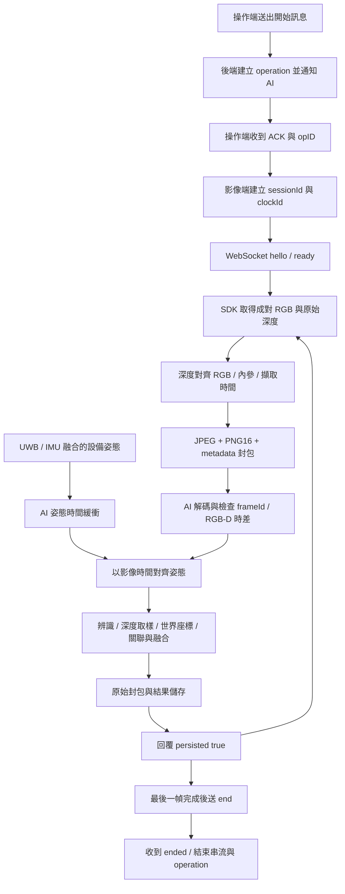

# 邊緣影像端串接說明書（RGB-D）

版本：2026-10-19。依 `AI/rgbd_sync.py`、`AI/rgbd_api.py`、`AI/test/rgbd_transport.py` 與目前啟動腳本整理。

本文件交付給 RGB-D 相機／邊緣運算組員，定義影像如何送入本系統、如何與設備姿態對時，以及伺服器如何確認處理與儲存。

## 1. 影像端需要完成的工作

1. 從相機 SDK 取得同一組彩色影像、原始深度與擷取時間。
2. 將深度對齊彩色影像座標；兩張影像大小一致。
3. 提供對齊後影像的正確內參、深度尺度與校正版本。
4. 一次把彩色 JPEG、無損 uint16 深度 PNG 與 metadata 包成一個 RGB-D 封包。
5. 使用 WebSocket 傳輸，等伺服器儲存確認後才傳下一組；斷線時重送同一幀。
6. 與定位端共用 operationId、sessionId、clockId 與可對齊的時間。
7. 結束前送完最後一幀，完成影像連線收尾，再結束操作。

目前實際支援的是 **自訂 RGB-D v1 封包經單一 WebSocket 傳輸**。先前討論的 RTSP 多 track 並不是目前此接收器已實作的格式。只提供一般彩色 RTSP 影片，還不足以完成同幀深度定位。

## 2. 整體流程與分工



| 角色 | 責任 |
|---|---|
| 邊緣相機端 | 相機驅動、成對擷取、深度對齊、編碼、封包、重送 |
| UWB／IMU 端 | 設備位置、四元數、量測時間與座標定義 |
| 平台 Node 後端 | 作業、原始感測資料、關聯與螺絲融合、資料庫、前端 API |
| Python AI | RGB-D 解碼、時間檢查、pose 對齊、辨識與深度定位、封包留存 |

辨識模型目前仍含 mock，完成封包交接不等於已完成真實 YOLO 與相機精度驗證。

## 3. 網路與連線位址

以 `<SERVER>` 表示邊緣端實際可連線的伺服器位址。

| 用途 | 位址 | 必要性 |
|---|---|---|
| MQTT 操作控制 | `mqtt://<SERVER>:1883` | 目前操作開始／結束流程使用 |
| RGB-D 同幀上傳 | `ws://<SERVER>:8000/ws/rgbd` | 此文件主要介面 |
| AI 同幀狀態 | `http://<SERVER>:8000/api/rgbd/status` | 聯調診斷 |
| 後端識別 | `http://<SERVER>:3000/api/device/runtime` | ACK 來源配對 |
| 彩色 RTSP 預覽／錄影 | `rtsp://<SERVER>:8554/cam-color` | 舊版預覽／獨立錄影需要時使用 |
| 深度 RTSP 預覽／錄影 | `rtsp://<SERVER>:8554/cam-depth` | 顯示用，可選 |
| 網站 | `http://<SERVER>:3000` | 使用者查看 |

**預設 WSL 腳本將服務綁定 127.0.0.1；Docker MQTT 也只映射到 loopback。** 因此同 Wi-Fi 的另一台設備不能直接照上述 SERVER 位址連入。需先約定使用區網監聽、受控反向代理或 VPN／SSH 通道，再設定實際 endpoint。這些跨機通路不是現有本機啟動腳本自動完成的功能。

在邊緣端填 `localhost`，連到的是邊緣端自己，不是伺服器。正式跨網路使用時需配置設備認證及加密；目前 WebSocket 原型本身沒有完整設備授權流程。

## 4. 操作與識別碼

### 4.1 開始作業

操作端先訂閱 `vision/operation/ack/<userId>`，再對 `vision/operation/start` 發送 QoS 2、retain=false：

```json
{
  "userId": "平台資料庫中已存在的24位使用者ID",
  "backendInstanceId": "由/api/device/runtime取得的值",
  "requestId": "每次開始新建一個UUID"
}
```

後端通知 AI 成功後回覆：

```json
{
  "opID": "6ad5d9ff2dda87cf45987ed7",
  "backendInstanceId": "與目標後端一致的值",
  "requestId": "與本次開始請求一致的值"
}
```

影像封包的 `operationId` 要填這裡的 `opID`，不能自行新建。backendInstanceId 與 requestId 可防止接到其他後端／舊請求的 ACK；目前 requestId 並非伺服器端 start 去重鍵，不要反覆送 start 重試。

### 4.2 各種 ID 的用途

| 欄位 | 規則 |
|---|---|
| `operationId` | 後端 ACK 的 24 位小寫十六進位操作 ID |
| `sessionId` | 影像端建立 UUID，並提供給定位端；同一次串流及短暫重連沿用 |
| `frameId` | 一組 RGB＋depth 共用的遞增整數，建議從 0 開始；不要每次重連歸零 |
| `clockId` | 此 session 使用的時間來源名稱；影像與 pose 完全一致 |
| `calibrationId` | 與伺服器相機外參設定的 key 一致，目前通常為 `default` |

目前一個 operation 只接受一個固定 RGB-D session，一次只有一個發布者；不是多相機／多人員協定。相機完全重啟而無法續用舊 ID／時間軸時，應結束舊操作，重新取得 operationId 與建立 session。

## 5. WebSocket 握手

### 5.1 建立連線後送 text JSON

```json
{
  "type": "hello",
  "operationId": "6ad5d9ff2dda87cf45987ed7",
  "sessionId": "67986f8b-a9ad-4675-92ed-3e177db09b4b",
  "clockId": "camera-unix-ns"
}
```

### 5.2 等待 ready

```json
{
  "type": "ready",
  "maxInFlight": 1,
  "lastFrameId": -1,
  "lastPoseTimeNs": null
}
```

- `lastFrameId=-1`：尚無已恢復／確認的上一幀。
- 重連時若 lastFrameId 已涵蓋本機等待中的幀，可依伺服器回覆處理，不要改變該幀 ID 後重送。
- maxInFlight=1：目前是 stop-and-wait，一幀確認後才送下一幀。
- 不匹配 operation 會回 `operation not ready`；先查啟用作業與 ACK 來源。
- 同 session 不可任意變更 clockId；建立新的 session 也需要新的 operation。
- 另一個發布者已連線時會以 WebSocket 1008 拒絕新增連線。

## 6. 同幀 RGB-D v1 二進位格式

每一組 RGB-D 以 **一個 WebSocket binary message** 傳送：

```text
┌─────────────────────┬─────────────────┬───────────────────┬───────────────────┐
│ 4 bytes             │ headerBytes     │ colorBytes        │ depthBytes        │
│ uint32 big-endian   │ UTF-8 JSON      │ JPEG              │ PNG, uint16       │
│ JSON header 長度    │ metadata        │ 彩色影像          │ 原始深度          │
└─────────────────────┴─────────────────┴───────────────────┴───────────────────┘
```

前四個 bytes 只表示 JSON header 的 UTF-8 **位元組長度**，不是字元數，也不是整個封包長度。長度格式是 network byte order／big-endian。JPEG／PNG 的整段編碼資料依序接在 JSON 後面，不能轉成 base64 混進 JSON。

### 6.1 Header 範例

```json
{
  "version": 1,
  "operationId": "6ad5d9ff2dda87cf45987ed7",
  "sessionId": "67986f8b-a9ad-4675-92ed-3e177db09b4b",
  "frameId": 0,
  "clockId": "camera-unix-ns",
  "colorCaptureTimeNs": "1792396800000000000",
  "depthCaptureTimeNs": "1792396800001000000",
  "calibrationId": "default",
  "depthScaleMeters": 0.001,
  "depthAlignedToColor": true,
  "dataSource": "sensor",
  "intrinsics": { "fx": 615.0, "fy": 615.0, "cx": 320.0, "cy": 180.0 },
  "colorEncoding": "jpeg",
  "depthEncoding": "png16",
  "width": 640,
  "height": 360,
  "colorBytes": 45000,
  "depthBytes": 180000
}
```

內參與長度是示例，**實際必須填相機校正結果與本幀編碼長度**。

| 欄位 | 型態／限制 | 意義 |
|---|---|---|
| version | integer，1 | 協定版本 |
| frameId | integer，0 到 2^53−1 | 單調遞增的成對影格 ID |
| colorCaptureTimeNs | 十進位 string，最多20位 | 彩色實際擷取時間，ns |
| depthCaptureTimeNs | 十進位 string，最多20位 | 深度實際擷取時間，ns |
| depthScaleMeters | number，0 < scale ≤ 1 | 原始深度值乘此係數得到 m |
| depthAlignedToColor | boolean，必須 true | 深度已在彩色影像像素座標中 |
| dataSource | `sensor` 或 `simulation` | 真實相機用 sensor |
| intrinsics.fx/fy/cx/cy | finite number，fx/fy > 0 | 傳輸影像的針孔相機內參，pixel |
| colorEncoding | `jpeg` | 彩色編碼 |
| depthEncoding | `png16` | 16-bit 無損深度編碼 |
| width/height | 正整數 | 彩色與深度的共同解析度 |
| colorBytes/depthBytes | 正整數 | 實際 JPEG／PNG 長度，bytes |

接收端上限：單封包 16 MiB；JSON header 16 KiB；影像寬×高不超過 4096×2160 像素。這是輸入限制，並非宣稱能以最高解析度即時處理。

### 6.2 彩色、深度與校正要求

- 彩色：三通道影像，以 JPEG 編碼。本專案 Python 編碼函數的輸入是 OpenCV BGR，若相機 SDK 回 RGB，先轉 BGR。
- 深度：單通道、二維 `uint16`、PNG 無損保存，與彩色同高同寬。
- 深度數值為 0 表示無效；目前定位取樣會排除 0。其他 SDK sentinel（如 65535）若代表無效，請先轉 0，不能當成有效距離傳入。
- 例如 raw=1500、scale=0.001，深度是 1.5 m。不能只傳黑白 8-bit 預覽、彩色化深度、H.264 壓縮深度或螢幕截圖來量測。
- `depthAlignedToColor=true` 是發送端聲明；接收器不會自動驗證相機幾何對齊是否正確。
- 深度需代表對齊彩色視點下的光軸深度 Z。若 SDK 回的是射線距離，需先做正確轉換。
- 伺服器目前沒有在此路徑套用畸變係數。送端應完成必要的去畸變／對齊，並給出處理後對應內參。
- 如果 resize／crop 影像，fx、fy、cx、cy 都要同步調整；不可改解析度後沿用舊內參。
- calibrationId 目前對應伺服器單一相機外參 profile；只有填字串不會上傳內外參設定。

## 7. 時間與 IMU／UWB 姿態同步

影像必須保留**擷取時間**，不是 JPEG 編碼後、publish 時、伺服器收到時或播放 MP4 的時間。

### 7.1 時鐘

- 建議轉換為 Unix epoch ns，以十進位字串傳送。
- 相機 SDK 若只有硬體啟動後的 monotonic ticks，需先校正 offset／單位，並處理時鐘漂移。
- 若影像與定位在不同裝置，需有雙方同意的對時機制與量測結果。
- clockId 只是辨識名稱；填相同名稱不會自動同步時鐘。
- color 與 depth 可以有各自 timestamp，但必須同屬可比較的時間基準。

### 7.2 姿態來源：選一種方式

**方式 A：同一個 WebSocket 傳姿態。** hello 成功後送 text JSON：

```json
{
  "type": "pose",
  "operationId": "6ad5d9ff2dda87cf45987ed7",
  "sessionId": "67986f8b-a9ad-4675-92ed-3e177db09b4b",
  "clockId": "camera-unix-ns",
  "timestampNs": "1792396800000000000",
  "position": { "x": 5.0, "y": 3.0, "z": 1.4 },
  "quaternion": { "w": 1.0, "x": 0.0, "y": 0.0, "z": 0.0 }
}
```

伺服器回 `{"type":"pose_accepted"}`。姿態必須來自設備定位結果，不能為了讓影像通過而隨意填零或地圖真值。

**方式 B：定位端經 MQTT `vision/device/pose` 提供姿態。** 影像端先 hello，並把 operationId／sessionId／clockId 告訴定位端。MQTT 姿態進入同一個 AI 緩衝；詳見 `MQTT_IMU_UWB_HANDOVER.md`。此時影像端不要再用測試姿態覆蓋它。

位置單位 m，四元數為設備→世界旋轉，具名 w/x/y/z，且非零、有限、正規化。位置指設備座標原點；相機相對設備的外參由平台另外設定。pose 時間須嚴格遞增；同時間戳重送目前不保證被當成成功。

### 7.3 現有對齊門檻

| 檢查 | 門檻／行為 |
|---|---|
| RGB 與 depth 擷取時間差 | 絕對值 ≤20 ms，超過則記錄 pair_time_mismatch，不做螺絲定位 |
| 設備 pose 左右樣本間隔 | ≤200 ms 才允許插值 |
| pose 位置 | 線性插值 |
| pose 四元數 | SLERP |
| 等待晚到 pose | 約100 ms，再依有無有效姿態處理 |
| 沒有對應姿態 | pose_unavailable；不拿舊姿態外推 |

若 pose 不與影像同時刻，影像時間需被有效的前、後 pose 夾住。設備姿態有獨立接收路徑，接收端等待時也允許其進入緩衝。

## 8. 逐幀傳輸與伺服器回覆

握手成功、姿態已就緒後，送出一個 RGB-D binary message，等待 text JSON 回覆：

```json
{
  "type": "result",
  "frameId": 0,
  "status": "localized",
  "persisted": true,
  "missingFrames": 0,
  "result": {}
}
```

實際 result 可能包含辨識、相機／世界座標、對齊姿態與外參；此處省略內容。後端執行關聯與螺絲融合，網站從後端 snapshot 取得其完整結果。

| status | 意義 |
|---|---|
| localized | 有可計算的螺絲世界量測；不等於已通過 Hungarian 地圖關聯 |
| no_detection | 沒有螺絲；設備姿態仍可保存 |
| invalid_depth | 沒有可用的螺絲深度量測 |
| pose_unavailable | 缺少可對齊的設備姿態 |
| calibration_mismatch | calibrationId 與平台設定不符 |
| pair_time_mismatch | RGB-D 時差超出門檻 |
| duplicate_or_out_of_order | 序號重複或倒退，不新增觀測 |
| non_monotonic_capture_time | 彩色擷取時間未遞增 |

`persisted=true` 表示該筆已經走過本機封包／結果與後端儲存確認；**不代表有辨識到螺絲，也不代表定位精度驗收通過**。no_detection 或時間差不符的紀錄，也可能成功保存。

錯誤回覆：

```json
{
  "type": "error",
  "error": "operation not ready",
  "persisted": false
}
```

正式發送端應以相符 frameId、成功儲存或重連 ready 恢復資訊決定是否移除待送幀。單憑 duplicate_or_out_of_order 字樣不能推論任意舊幀一定已成功寫入資料庫。

## 9. 掉幀、背壓與重連

### 發送端規則

1. 同時最多保留一組「已送出、等待 ACK」的封包。
2. ACK 前保留這組原始 bytes、ID、metadata 與擷取時間，重試不能重新讀影像來冒充同一幀。
3. 如果相機持續出幀而網路處理不及，可在發送前丟棄**整組**未送出的 RGB-D，不能拿新 color 配舊 depth。
4. 保留原始擷取時間與 frameId 缺口；不以 frameId/FPS 捏造新時間。
5. 重連沿用 operationId、sessionId、clockId，重新 hello，讀取 lastFrameId／lastPoseTimeNs。
6. 需要重送時傳相同封包；不要重新建立 operation 或把 frameId 歸零。

目前測試 transport 的設定：開連線 timeout 3 s、回覆 timeout 8 s、最多30次嘗試、失敗間隔0.25 s。這是測試程式設定，不能解讀為任何網路都可承受長時間離線。

伺服器等待下一個 WebSocket message 約10 s，超過會關閉連線。RGB-D watchdog 在距離上次 hello／封包約10 s 後可能結束操作；初始尚未開始影像時另外有120 s等待。這些為目前程式門檻，實際仍受排程與其他處理影響。不要持續重送 hello 來掩蓋相機已斷流。

### 伺服器保存與補寫

- 原始 RGB-D 封包、深度預覽與處理快照先留在 AI 本機。
- 後端失敗時保留 pending journal，後續按序補寫；不因前端無人觀看而停止記錄。
- 同一 operation／session／frame 為唯一鍵，重試不應再多算一次螺絲觀測。
- 背景目前約每5秒嘗試補寫；結束後僅允許符合既有本機 journal 條件的資料恢復。
- 設計目前以單一 Node／AI 實例為主，多副本與跨程序排序另需處理。

## 10. 正常結束流程

1. 停止取得新的待送影格。
2. 等最後一幀儲存確認，仍需重試者完成或明確報錯。
3. 在同一 WebSocket 送：

```json
{ "type": "end" }
```

4. 收到：

```json
{ "type": "ended", "lastFrameId": 123 }
```

5. 關閉 WebSocket 與選用的 RTSP 發送器。
6. 操作端再對 `vision/operation/end` 發送：

```json
{
  "opID": "6ad5d9ff2dda87cf45987ed7",
  "endTime": "2026-10-19T08:00:00.000Z",
  "description": "Camera acquisition stopped"
}
```

WebSocket ended 代表此連線收尾與現有 pending 補寫已完成，**不會單憑此訊息直接完成整個 Operation 的結束／三種歷史演算法重算**。仍要完成 MQTT 操作結束流程，並等後端重算完成。

## 11. 邊緣端 Python 封包實作範例

可直接沿用本專案 `AI/rgbd_sync.py` 的 `encode_packet()` 與 `AI/test/rgbd_transport.py` 的 `PairedPublisher`。相機 SDK 與人員定位演算法 adapter 由對應組員提供。

下列是**函式整合範本**，不是一個會自動開啟真實相機的完整驅動程式：

```python
import sys
from pathlib import Path
import numpy as np

# 依部署位置調整；下例假設在專案根目錄啟動
sys.path.insert(0, str(Path("AI").resolve()))
sys.path.insert(0, str(Path("AI/test").resolve()))
from rgbd_sync import encode_packet
from rgbd_transport import PairedPublisher


async def upload_one(transport, header, color_bgr, depth_u16, matched_pose):
    """header 與 pose 的時間皆由實際擷取／定位流程提供。"""
    assert depth_u16.dtype == np.uint16 and depth_u16.ndim == 2
    assert color_bgr.dtype == np.uint8 and color_bgr.ndim == 3
    assert color_bgr.shape[2] == 3
    assert color_bgr.shape[:2] == depth_u16.shape
    packet = encode_packet(header, color_bgr, depth_u16)
    # frame() 會握手、傳 pose、送二進位封包，並處理有限次重連／重試。
    # 若姿態另走 MQTT，應依本文協定寫 image-only 發送流程，
    # 不要用這個會額外送 matched_pose 的 helper 混入第二組姿態。
    return await transport.frame(header["frameId"], matched_pose, packet)
```

header 至少由送端提供：operationId、sessionId、frameId、clockId、兩個 captureTimeNs、calibrationId、depthScaleMeters、depthAlignedToColor、dataSource、intrinsics。encode_packet 會補上 version、編碼、解析度及編碼長度。

若自行實作其他語言，封包組裝等同：

```python
import json
import struct

def pack_encoded(header, jpeg_bytes, png16_bytes):
    h = dict(header, colorBytes=len(jpeg_bytes), depthBytes=len(png16_bytes))
    raw_header = json.dumps(h, allow_nan=False).encode("utf-8")
    return struct.pack("!I", len(raw_header)) + raw_header + jpeg_bytes + png16_bytes
```

這個低階函式假定 header 的 version、encoding、width／height 等完整且正確，並假定 jpeg_bytes／png16_bytes 已由正確的影像編碼器產生。

## 12. RTSP 舊版預覽／獨立錄影

同幀 WebSocket 已攜帶彩色與原始深度，平台同幀播放器直接使用封包影像。若需要舊版 RTSP 預覽或獨立錄影，可以另發：

```bash
ffmpeg -re -stream_loop -1 -i test_color.mp4 -c:v copy -an \
  -rtsp_transport tcp -f rtsp rtsp://SERVER:8554/cam-color

ffmpeg -re -stream_loop -1 -i test_depth.mp4 -c:v copy -an \
  -rtsp_transport tcp -f rtsp rtsp://SERVER:8554/cam-depth
```

這是測試檔案發布範例；真實相機要由 SDK／編碼器供應即時影格，不能把讀 MP4 當成相機硬體串接。`-c:v copy` 保留來源編碼，不會自動移除 H.264 B-frames；舊版 WebRTC 預覽曾遇到此相容問題，須檢查來源編碼設定。

深度 RTSP 是視覺預覽，不能取代 WebSocket 的原始 uint16 深度。獨立 RTSP 的 MP4 目前沒有與 RGB-D frameId 建立逐幀 PTS 對照；歷史同幀同步使用封包擷取時間索引。

## 13. 聯調驗收順序

1. 確認邊緣端真的能連到 broker、後端識別 API 與 RGB-D WebSocket，先處理 localhost／區網監聽問題。
2. 用已有帳號開始 operation，確認 ACK 的 ID、後端 instance 與 request 都符合本次請求。
3. hello 後拿到 ready，再開始 pose／RGB-D；確認只有一個發布者。
4. 先傳固定尺寸、小量10幀，確認各幀 persisted=true、伺服器影像可讀、frameId 不重複。
5. 對已知1 m／2 m平面檢查原始深度尺度，不只看灰階畫面是否像深度。
6. 以彩色／深度邊緣檢查 alignment；確認 bbox 中心真的落在該物件的深度像素。
7. 設備靜止、只旋轉、只平移各測一次，檢查時間／姿態／外參方向。
8. 刻意掉整組幀、短斷線與重送，確認不錯配、不重複增加螺絲觀測。
9. no_detection 時確認設備姿態仍保存；暫停前端後後端仍繼續寫入。
10. 正常結束後查歷史；影像、bbox、設備與螺絲在暫停／拖曳時對應同一筆時間資料。

僅有 frameId 相同不能證明 SDK 硬體同步；最終需保留相機原始時間戳、配對依據與可查驗的紀錄。

## 14. 影像組員應交付的項目

| 項目 | 需要內容 |
|---|---|
| 相機 | 型號、SDK、作業系統、序號／設備識別 |
| 擷取 | 彩色／深度解析度、FPS、SDK 成對方式、是否硬體同步 |
| 時間 | 原始 timestamp 單位與來源、轉 Unix ns 的方式、與定位端對時方法 |
| 深度 | 原始型別、scale、無效值、Z-depth／射線距離定義 |
| 內參 | 對齊／去畸變／縮放後的 fx、fy、cx、cy |
| 外參 | 相機相對設備的旋轉與平移，安裝座標定義 |
| 傳輸 | WebSocket endpoint、編碼、上限、重試與緩衝丟幀策略 |
| 識別 | operation／session／clock 與定位組員交換方式 |
| 程式 | 可獨立執行的發送程式、依賴版本、啟動／停止方式 |
| 樣本 | 一組 color、原始 uint16 depth、metadata、對應 pose 及已知距離標的 |

## 15. 常見回覆與定位方式

| 訊息 | 優先檢查 |
|---|---|
| operation not ready | ACK 是否來自同一後端；AI 是否接受該 operation；操作是否已結束 |
| send hello with matching session/clock first | metadata 與 hello 是否完全一致 |
| pose operation/session/clock mismatch | 定位端是否沿用相機端的三個 ID |
| pose timestamps must increase | 重送、時鐘歸零或不同姿態來源混用 |
| depth must be aligned to color | 是否有真正先做 SDK alignment，並填 true |
| decoded image shape/type mismatch | 深度是否為 uint16 PNG，兩張影像尺寸是否一致 |
| payload length mismatch | header UTF-8 長度、JPEG／PNG bytes 計算錯誤 |
| pair_time_mismatch | color／depth 時差與時鐘單位 |
| pose_unavailable | 缺 pose、沒有右側插值樣本或間隔超過200 ms |
| calibration_mismatch | calibrationId 與平台 profile key |
| 無法連線 | 服務綁 loopback、WSL轉送、位址填錯或防火牆 |

狀態查詢：

```bash
curl http://127.0.0.1:8000/api/rgbd/status
```

伺服器日誌與資料：

```text
runtime/linux/ai.log
runtime/linux/backend.log
AI/video/rgbd/<operationId>/<sessionId>/<frameId補成12位>.rgbd
AI/video/rgbd/<operationId>/<sessionId>/<frameId補成12位>.json
AI/video/rgbd/<operationId>/<sessionId>/<frameId補成12位>.depth.jpg
MongoDB vision_system.rgbdframes
```

`.rgbd` 內保存原始 uint16 深度；`.depth.jpg` 僅為顯示用。這些檔案及資料庫需一起保留，不能只備份 MP4 來期待完整重播定位。

## 16. 相關程式與文件

- `AI/rgbd_sync.py`：RGB-D v1 封包、深度反投影、pose 插值。
- `AI/rgbd_api.py`：握手、姿態、ACK、封包／結果與補寫。
- `AI/test/rgbd_transport.py`：同 session 重連與同幀重送參考。
- `AI/test/rgbd_sender.py`：成對讀取 test_color.mp4／test_depth.mp4；灰階深度採示範映射，不是相機驅動或實測深度。
- `RGBD_PAIRED_VIDEO.md`：測試影片的共同區段、配對規則、灰階映射及驗證方式。
- `AI/test/test2.py`：操作開始／結束、ACK 配對與測試程序管理。
- `MQTT_IMU_UWB_HANDOVER.md`：定位端資料契約。
- `RGBD_DEVICE_INTEGRATION.md`：設備定位與同幀前端整合。
- `WSL_DEPLOYMENT_COMMANDS.md`：部署、啟停及資料庫指令。
